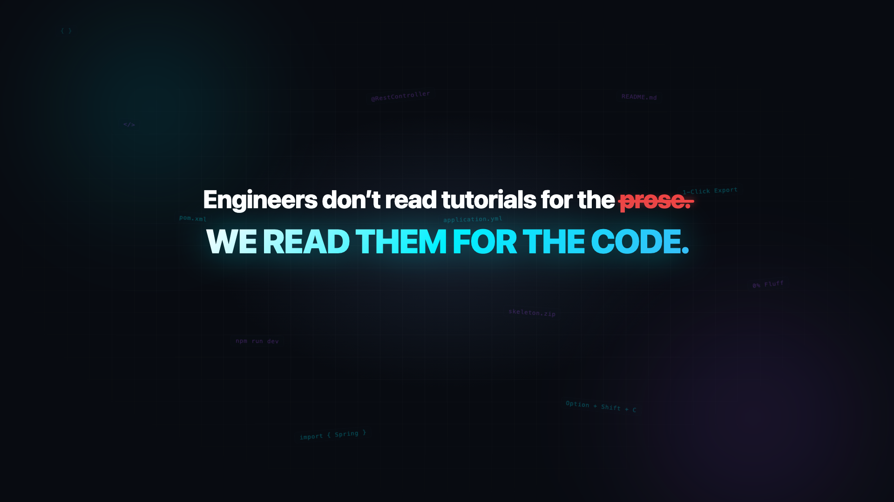
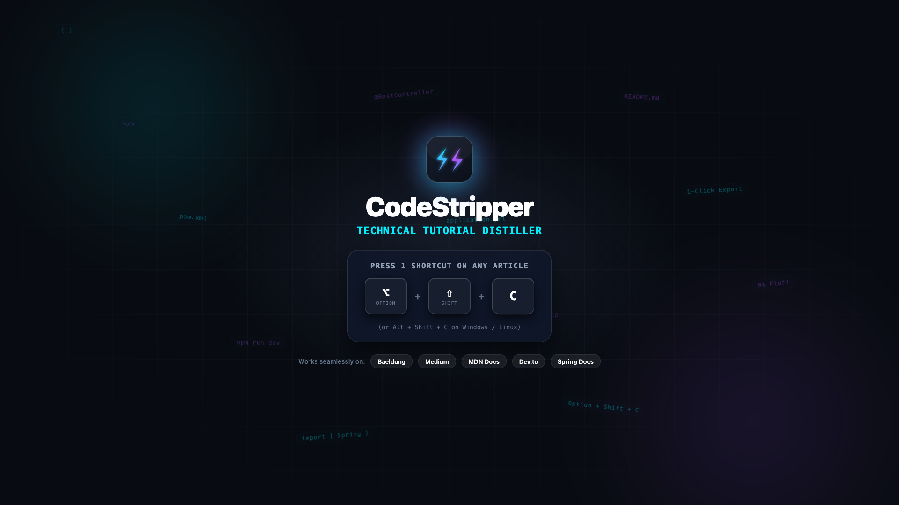
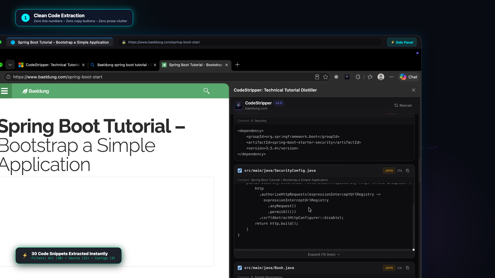
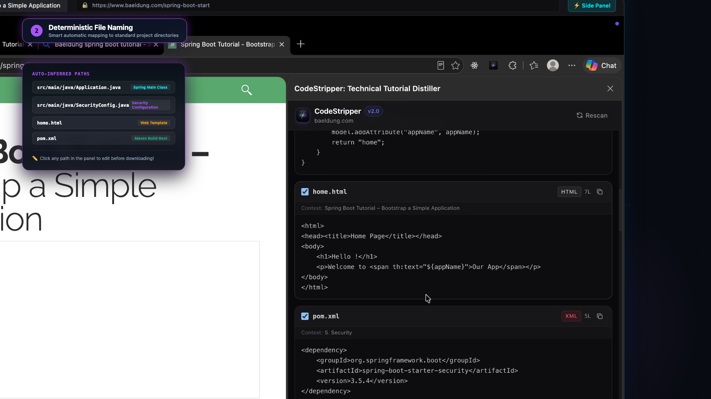
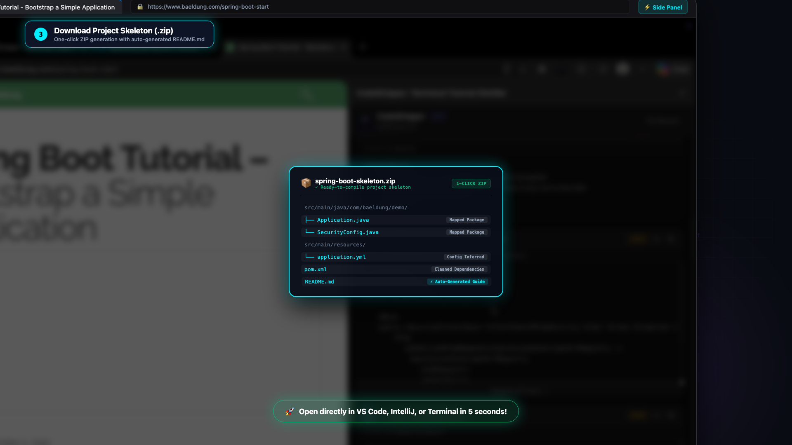
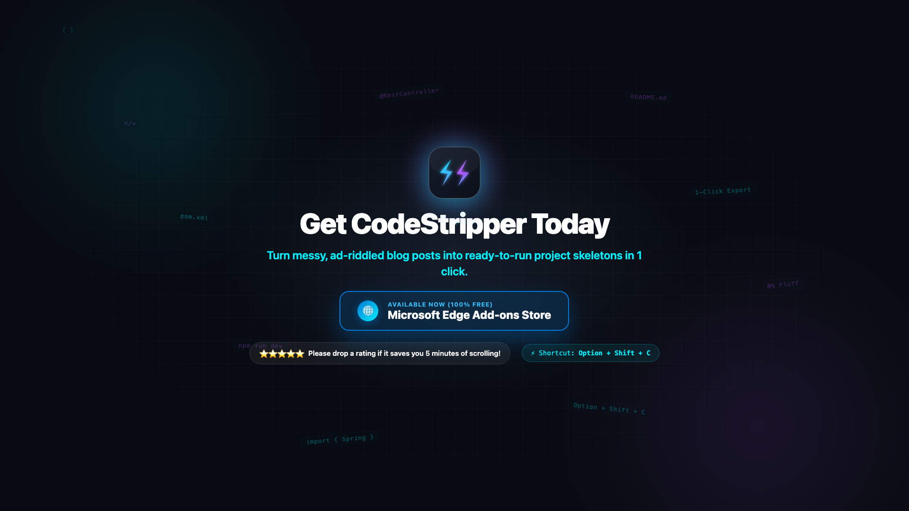
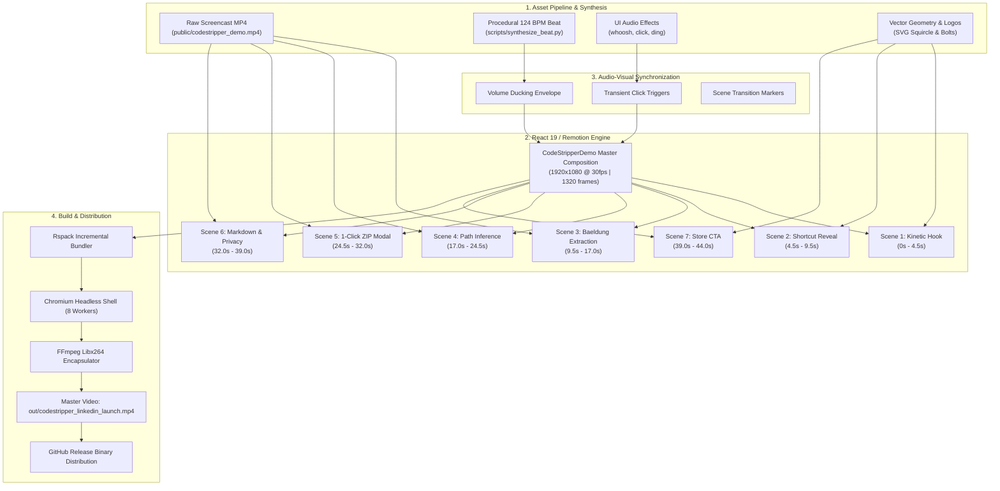

# CodeStripper Demo Video Engine

<p align="center">
  <em>High-performance programmatic motion graphics and launch video production engine for <strong>CodeStripper: Technical Tutorial Distiller</strong> — engineered for sub-second developer retention, kinetic UI interactions, and procedural multi-track audio synthesis.</em>
</p>

<p align="center">
  
  
  
  
  
  
  
</p>

<p align="center">
  <!-- PRIMARY ACTION BUTTONS -->
  <a href="https://github.com/RayAashish/codestripper-demo-video/releases/download/v2026.11.14/codestripper_linkedin_launch.mp4">
    
  </a>
  <a href="https://microsoftedge.microsoft.com/addons/detail/codestripper-technical-t/hicjkkopfkoeopphhhccfejpkhkcglaa">
    
  </a>
  <a href="https://github.com/RayAashish/chrome-extensions/tree/main/code-stripper">
    
  </a>
</p>

---

## Visual Showcase & Timeline

<p align="center">
  
  
</p>
<p align="center">
  
  
</p>
<p align="center">
  
  
</p>

---

## Overview & Key Highlights

- **Problem Statement:** Traditional product demos rely on generic screen recordings that suffer from sluggish pacing, distracting desktop clutter, poor typography, and lack of auditory feedback. Viewers drop off within the first 3 seconds, missing key architectural differentiators.
- **Core Value Proposition:** This project provides an enterprise-grade programmatic video rendering pipeline built with React and Remotion. Every camera move, mechanical key press, particle emitter, and UI layer is expressed as declarative, mathematically deterministic code with frame-perfect audio synchronization.
- **Feature Matrix:**
  - **Declarative Motion Timing:** 44.0-second timeline (1,320 frames @ 30 FPS) structured around human attention spans and social feed autoplay algorithms.
  - **Interactive 3D Elements:** Animated mechanical keycap presses (`⌥ Option + ⇧ Shift + C`), dynamic browser viewports, and glassmorphic modal popups.
  - **Procedural Audio Synthesis:** Zero-dependency Python audio synthesizer (`scripts/synthesize_beat.py`) generating a 124 BPM electronic tech beat mapped to D-minor chords with punchy 808 subs.
  - **Synchronized Audio Events:** Hardware-accelerated UI sound design including spatial whoosh transitions, mechanical clicks, and zip completion chimes.
  - **Chrome Headless Acceleration:** Multi-threaded parallel frame rendering via Rspack and Chromium Headless Shell with zero external cloud dependencies.

---

## System Architecture & Workflow

### High-Level Architecture Diagram



### Component Breakdown

⚬ **Presentation Layer:**
- `CodeStripperLogo`: Procedural SVG squircle featuring dual neon-glow lightning bolts with reactive scale pulses.
- `ParticleBackground`: Floating ambient gradient blobs with developer grid overlays and 12 drifting code tokens (`pom.xml`, `application.yml`, `Option + Shift + C`).
- `BrowserFrame`: Modern dark-mode browser mockup with macOS window controls, dynamic tab headers, and 3D perspective transforms (`rotateX`, `rotateY`, `scale`).
- `KeyboardShortcut`: Interactive 3D mechanical keycaps with realistic spring-damper depression physics and cyan neon key travel illumination.
- `ZipTreeModal`: Glassmorphic directory tree container showcasing deterministic Spring Boot folder hierarchies and auto-generated `README.md` artifacts.
- `FeatureBadge`: High-contrast pill badges styled with color-coded luminescence (Cyan, Purple, Emerald, Amber).

⚬ **Core Engine / Processing:**
- `remotion.config.ts`: Rspack-enabled bundler configuration with JPEG intermediate caching and automated stream multiplexing.
- `TIMINGS` Registry: Centralized frame map enforcing strict scene entry/exit boundaries across 1,320 frames.
- `scripts/synthesize_beat.py`: In-memory waveform synthesis generating a 16-bit 44.1kHz stereo PCM soundtrack using pure mathematical functions (`tanh` saturation, envelope decays, and melodic arpeggiators).

⚬ **Data & I/O:**
- `public/sfx/`: Low-latency uncompressed WAV audio buffers for tactile user interactions.
- `public/stills/`: Rendered keyframes utilized for promotional cards, thumbnails, and documentation badges.
- `GitHub Releases`: Offloaded binary distribution network ensuring the core Git tree remains featherlight (<2 MB).

---

## Project Structure

```text
codestripper-demo-video/
├── .env.example                               # Environment template for render workers
├── .gitignore                                 # Strict multi-layer security & binary exclusion rules
├── eslint.config.mjs                          # Flat ESLint configuration with Remotion lint rules
├── package.json                               # Dependencies & build scripts
├── remotion.config.ts                         # Remotion CLI & Rspack compilation settings
├── tsconfig.json                              # TypeScript strict compiler configuration
├── public/                                    # Public assets served via staticFile()
│   ├── sfx/                                   # Tactile audio samples (ding, click, whoosh)
│   ├── stills/                                # Exported promotional frame captures
│   └── tech_beat.wav                          # Synthesized 124 BPM soundtrack
├── scripts/
│   └── synthesize_beat.py                     # Zero-dependency Python audio synthesizer
├── src/
│   ├── index.ts                               # Remotion root entrypoint
│   ├── Root.tsx                               # Master composition catalog
│   └── CodeStripperDemo/                      # Core demo video production module
│       ├── constants.ts                       # Palette, font hierarchies, and frame timeline
│       ├── index.tsx                          # Timeline sequence orchestrator
│       ├── components/
│       │   ├── BrowserFrame.tsx               # macOS styled dark browser viewport
│       │   ├── CodeStripperLogo.tsx           # Vector squircle logo with neon glow
│       │   ├── FeatureBadge.tsx               # Numbered value proposition pills
│       │   ├── KeyboardShortcut.tsx           # 3D mechanical keypress component
│       │   ├── ParticleBackground.tsx         # Cybernetic grid & drifting tokens
│       │   └── ZipTreeModal.tsx               # 3D file tree modal with badges
│       └── scenes/
│           ├── Scene1Hook.tsx                 # 0.0s - 4.5s: "We read tutorials for the code"
│           ├── Scene2Trigger.tsx              # 4.5s - 9.5s: Shortcut keypress & platform pills
│           ├── Scene3Extraction.tsx           # 9.5s - 17.0s: Baeldung Spring Boot extraction
│           ├── Scene4FileNaming.tsx           # 17.0s - 24.5s: Deterministic path mapping
│           ├── Scene5ZipDownload.tsx          # 24.5s - 32.0s: 1-Click ZIP generation
│           ├── Scene6MarkdownObsidian.tsx     # 32.0s - 39.0s: Markdown export & privacy shield
│           └── Scene7Outro.tsx                # 39.0s - 44.0s: Edge Store download CTA
└── out/                                       # Git-ignored production render outputs
    └── codestripper_linkedin_launch.mp4       # Master 1080p release video
```

---

## Getting Started & Local Setup

### Prerequisites

⚬ **Node.js**: `v20.19.0`, `v22.13.0`, or `>=v24.0.0`  
⚬ **Package Manager**: `npm` (v10+) or `pnpm` / `bun`  
⚬ **Python**: `python3` (3.9+) for procedural beat synthesis  
⚬ **Browser**: Google Chrome or Chromium (for Remotion Studio & Headless Shell rendering)

### Installation & Run

1. **Clone the repository:**
   ```bash
   git clone https://github.com/RayAashish/codestripper-demo-video.git
   cd codestripper-demo-video
   ```

2. **Configure environment:**
   ```bash
   cp .env.example .env
   ```

3. **Install dependencies:**
   ```bash
   npm install
   ```

4. **(Optional) Re-synthesize audio soundtrack:**
   ```bash
   python3 scripts/synthesize_beat.py
   ```

5. **Launch interactive Remotion Studio:**
   ```bash
   npm run dev
   ```
   *Navigate to [http://localhost:3000](http://localhost:3000) to inspect and scrub frames in real time.*

6. **Render high-resolution stills:**
   ```bash
   npx remotion still CodeStripperDemo public/stills/frame_60.png --frame 60
   ```

7. **Render production master video:**
   ```bash
   npx remotion render CodeStripperDemo out/codestripper_linkedin_launch.mp4 --concurrency=8
   ```

---

## Privacy, Permissions & Security

⚬ **Air-Gapped Rendering:** All video textures, typography, styling, and audio layers are loaded strictly from local file descriptors. No external fonts, analytics trackers, or remote CDN scripts are fetched during compilation.  
⚬ **Zero Telemetry:** The video engine runs 100% locally on the host machine without telemetry or metrics logging.  
⚬ **Sanitized Git Tree:** Heavy raw screen captures (`*.mov`), video renders (`out/`), and temporary analysis caches are excluded via `.gitignore` to prevent repository bloat and credential exposure.

---

## License & Attribution

This project is open-source software licensed under the [MIT License](LICENSE).  
Developed with passion by [Aashish Kumar Ray](https://github.com/RayAashish).

CodeStripper is available on the [Microsoft Edge Add-ons Store](https://microsoftedge.microsoft.com/addons/detail/codestripper-technical-t/hicjkkopfkoeopphhhccfejpkhkcglaa).
